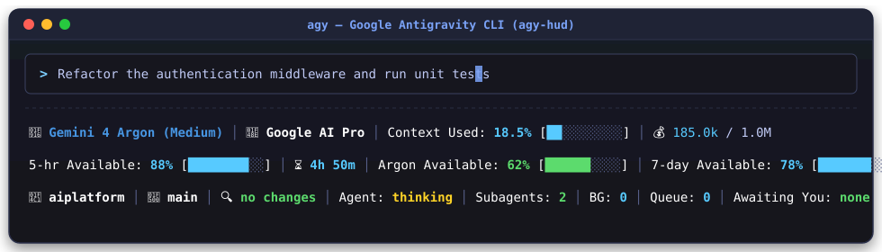
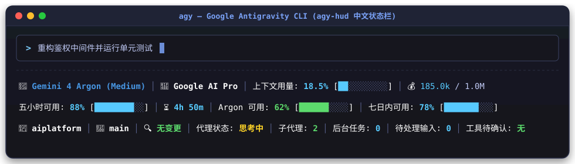

# antigravity-cli-hud

English | [简体中文](README.zh-CN.md)

[](plugin.json)
[](LICENSE)
[]()

A **[claude-hud](https://github.com/jarrodwatts/claude-hud) inspired** multi-line Heads-Up Display (HUD) and statusline plugin for the **Google Antigravity CLI (`agy`)**, **Antigravity IDE**, and **Antigravity 2.0 Desktop**.

It renders directly below your terminal input box—no `tmux` or separate windows required—providing real-time visibility into your active AI model, context window consumption, 5-hour / weekly / Gemini 4 Argon API quotas, Git branch state, and running subagents or background tasks with **zero LLM token overhead**.

---

## 📸 Screenshots

### English (`us`)


### Simplified Chinese (`zh-cn`)


---

## ✨ Key Features

- **Authentic `jarrodwatts/claude-hud` Terminal Aesthetics**:
  - **Row 1 — Model, Full Path, Context & Token Speed**: Bracketed brand model `[Gemini 3.8 Flash]`, full workspace path with zsh-style Git branch `git:(main*)`, unified context progress bar `Context [░░░░░░░░░░] 6.2% (65.0k/1.0M)`, and real-time token speed `⚡ 72.0 t/s`.
  - **Row 2 — Real-Time Quota Pools**: 5-hour rolling quota with inline reset countdown `5h Limit [█████████░] 96% (4h 20m)`, dedicated **Gemini 4 Argon** bar, and weekly quota bar.
  - **Row 3 — Live Session Tool Activity & Telemetry**: Status indicator `● Idle`, live tool execution stats tailed from transcript `✓ run_command ×8 │ ✓ read_file ×5`, running subagents and background tasks.
  - **Row 2 — Real-Time Quota Pools**: 5-hour rolling quota percentage + progress bar + reset countdown, dedicated **Gemini 4 Argon** quota bar, and 7-day weekly quota bar.
  - **Row 3 — Workspace, Git & Agent Telemetry**: Current project folder, Git branch & uncommitted status, live agent state (`idle` / `thinking` / `working` / `tool_use`), active subagents count, background tasks count, input queue, and pending tool confirmation alerts.
- **24-Bit Four-Tier Dynamic Color Coding**:
  - `100% – 75%`: Blue (`#57caff`)
  - `74% – 50%`: Green (`#5cdb6d`)
  - `49% – 25%`: Yellow (`#ffd427`)
  - `24% – 0%`: Red/Pink (`#ff7daf`)
- **Zero Token Overhead**: Polls the local Antigravity Language Server RPC endpoint directly in the background with smart disk caching.
- **Multi-Language Support**: Supports English (`us`), Simplified Chinese (`zh-cn`), Traditional Chinese (`zh-tw`), and Japanese (`jp`).
- **Cross-Platform**: Pure Node.js (`.mjs`) implementation supporting Windows, macOS, and Linux.

---

## 🚀 Installation

### Prerequisites
- **Node.js** (v18+ required)
- **Git** (optional, for branch and dirty state tracking)

### Option 1: Install via Antigravity Plugin Manager

```bash
agy plugin install https://github.com/jiangwanyutao/antigravity-cli-hud
```

### Option 2: One-Click Global Install (Windows PowerShell)

Clone the repository and run the included installer script:

```powershell
git clone https://github.com/jiangwanyutao/antigravity-cli-hud.git
cd antigravity-cli-hud
powershell -ExecutionPolicy Bypass -File .\install.ps1
```

### Option 3: Bind Directly Inside `agy` CLI

Inside an active `agy` CLI session, run:

```text
/statusline node /absolute/path/to/antigravity-cli-hud/skills/agy-hud/scripts/statusline-quota.mjs
```

> **Note**: When enabling the statusline hook for the first time, restart `agy` CLI (exit and reopen) to load the hook process. Subsequent changes to `settings.json` hot-reload automatically!

---

## ⚙️ Customization

You can customize the language, bar length, label style (`text` vs. `emoji`), or indicator order in `~/.gemini/antigravity-cli/settings.json` (or `<workspace>/.gemini/settings.json`):

```json
{
  "ui": {
    "language": "us",
    "footer": {
      "labelStyle": "text",
      "barLength": 10,
      "items": [
        "model-name",
        "plan-tier",
        "context-used",
        "context-used-bar",
        "token-count",
        "n",
        "quota",
        "quota-bar",
        "quota-reset-countdown",
        "quota-argon",
        "quota-argon-bar",
        "quota-weekly",
        "quota-weekly-bar",
        "n",
        "project-path",
        "git-branch",
        "vcs-dirty",
        "agent-state",
        "subagents",
        "background-tasks",
        "pending-input",
        "tool-confirmation"
      ],
      "itemStyles": {
        "model-name": "emoji",
        "plan-tier": "emoji",
        "token-count": "emoji",
        "quota-reset-countdown": "emoji",
        "project-path": "emoji",
        "git-branch": "emoji",
        "vcs-dirty": "emoji"
      }
    }
  }
}
```

- Set `"language"` to `"us"` (English), `"zh-cn"` (Simplified Chinese), `"zh-tw"` (Traditional Chinese), or `"jp"` (Japanese).
- Use `"n"` inside `"items"` to insert a manual line break.

---

## 🙏 Acknowledgements

- Visual layout inspired by [jarrodwatts/claude-hud](https://github.com/jarrodwatts/claude-hud).
- Core quota telemetry and statusline rendering engine based on [AndyAWD/antigravity-cli-statusline](https://github.com/AndyAWD/antigravity-cli-statusline) under the MIT License.

---

## 📄 License

Released under the [MIT License](LICENSE).
