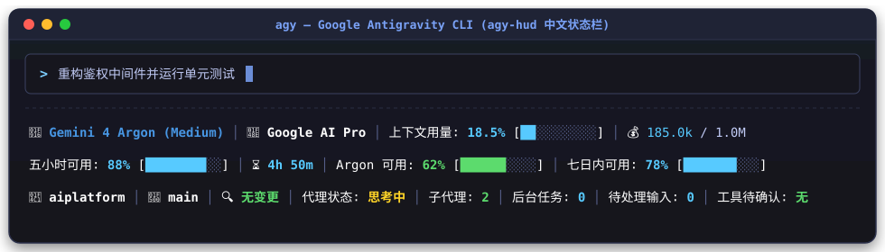
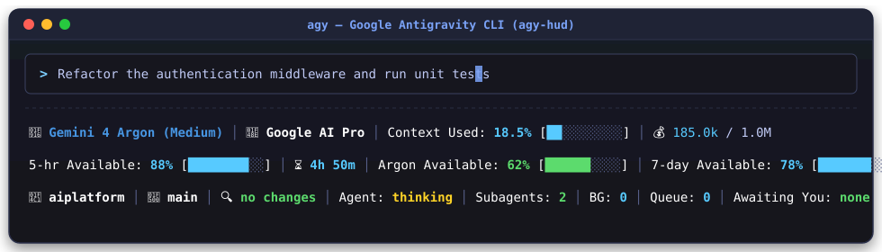

# antigravity-cli-hud

[English](README.md) | 简体中文

[](plugin.json)
[](LICENSE)
[]()

深度参考并对齐 **[jarrodwatts/claude-hud](https://github.com/jarrodwatts/claude-hud)** 终端美学与功能架构的 **Google Antigravity CLI (`agy`)**、**Antigravity IDE** 与 **Antigravity 2.0 桌面端**多行状态栏（HUD）插件。

它直接渲染在终端输入框正下方（无需 `tmux` 或额外分屏），以**零额外 Token 消耗**实时展示当前模型、工作区完整路径、Zsh 风格 Git 分支、上下文窗口占用、实时 Token 输出测速、5 小时/每周/Argon 配额池倒计时，以及会话日志实时工具调用追踪。

---

## 📸 界面效果

```text
[Gemini 3.8 Flash] │ D:\project git:(main*) │ Context [░░░░░░░░░░] 6.2% (65.0k/1.0M) │ ⚡ 72.0 t/s
5h可用 [█████████░] 96% (4h 20m) │ Argon [███████░░░] 79% (5d 17h) │ 七日可用 [████████░░] 85% (5d 17h)
● 闲置 │ ✓ run_command ×8 │ ✓ read_file ×5 │ ✓ write_file ×2 │ ⑂ 0 │ ⚙ 0
```

### 简体中文 (`zh-cn`)


### English (`us`)


---

## ✨ 核心特性

- **原生深度复刻 `jarrodwatts/claude-hud` 终端美学**：
  - **第 1 行 — 模型、完整绝对路径、上下文与输出速率**：中括号专属品牌高亮模型 `[Gemini 3.8 Flash]`、工作区绝对完整路径与 Zsh 风格 Git 分支 `D:\project git:(main*)`（Clean 绿 / Dirty 黄带星号）、一体化上下文进度条与绝对计数 `Context [░░░░░░░░░░] 6.2% (65.0k/1.0M)`、实时 Token 流式生成速率 `⚡ 72.0 t/s`。
  - **第 2 行 — 多维实时配额池与内联倒计时**：5 小时滚动配额 `5h可用 [█████████░] 96% (4h 20m)`、**Gemini 4 Argon** 专属配额进度条、7 日周配额进度条。
  - **第 3 行 — 会话工具动态追踪与代理状态**：状态指示灯 `● 闲置`、实时 Tail 会话 `transcript.jsonl` 的工具调用频次 `✓ run_command ×8 │ ✓ read_file ×5`、子代理与后台任务计数。
- **现代化组件库图标体系（告别粗糙 AI Emoji）**：
  - 默认采用类似 **Lucide Icons** 与现代终端工具的极简符号（`✦`、`★`、`◈`、`⚡`、`◷`、`⎇`、`●`、`⑂`、`⚙`）。
  - 支持通过配置一键切换到 **Nerd Fonts** 原生字符（如 ``、`󰚩`、`󰍛`、`󱐋` 等）。
- **24-Bit 四级动态色彩预警**：
  - `100% – 75%`：蓝色 (`#57caff`)
  - `74% – 50%`：绿色 (`#5cdb6d`)
  - `49% – 25%`：黄色 (`#ffd427`)
  - `24% – 0%`：粉红/红色 (`#ff7daf`)
- **零额外 Token 消耗**：后台直接连接本地 Antigravity Language Server RPC 接口获取实时配额，并具备智能磁盘缓存。
- **多语言切换与热重载**：支持简体中文 (`zh-cn`)、英文 (`us`)、繁体中文 (`zh-tw`) 与日文 (`jp`)，修改 `settings.json` 后无需重启 CLI 即可热更新生效。
- **跨平台兼容**：纯 Node.js (`.mjs`) 实现，原生支持 Windows、macOS 和 Linux。

---

## 🚀 安装指南

### 环境要求
- **Node.js**（v18 及以上）
- **Git**（可选，用于显示分支与未提交状态）

### 方式一：通过 Antigravity 插件管理器安装

```bash
agy plugin install https://github.com/jiangwanyutao/antigravity-cli-hud
```

### 方式二：Windows PowerShell 一键全局安装

克隆仓库并执行内置的一键安装脚本：

```powershell
git clone https://github.com/jiangwanyutao/antigravity-cli-hud.git
cd antigravity-cli-hud
powershell -ExecutionPolicy Bypass -File .\install.ps1
```

### 方式三：在 `agy` CLI 中直接绑定

在 `agy` 交互式终端中输入：

```text
/statusline node /绝对路径/antigravity-cli-hud/skills/agy-hud/scripts/statusline-quota.mjs
```

> **提示**：首次启用状态栏挂钩（Hook）时，请退出并重新打开一次 `agy` CLI 以加载挂钩进程。启用后对 `settings.json` 的任何布局或语言修改都会**立即热更新生效**，无需重启！

---

## ⚙️ 自定义配置

你可以在 `~/.gemini/antigravity-cli/settings.json`（或项目工作区的 `.gemini/settings.json`）中配置 HUD 参数：

```json
{
  "ui": {
    "language": "zh-cn",
    "footer": {
      "layout": "claude-hud",
      "iconTheme": "lucide",
      "barLength": 10
    }
  }
}
```

### 配置项说明：

| 配置项 | 类型 | 默认值 | 可选值 / 说明 |
| :--- | :--- | :--- | :--- |
| `ui.language` | string | `"zh-cn"` | `"zh-cn"`（简体）、`"us"`（英文）、`"zh-tw"`（繁体）、`"jp"`（日文） |
| `ui.footer.layout` | string | `"claude-hud"` | `"claude-hud"`（原生3行极简HUD）或 `"modular"`（旧版自定义条目拼装） |
| `ui.footer.iconTheme` | string | `"lucide"` | `"lucide"`（极简符号）、`"nerd"`（Nerd Fonts字符）、`"classic-emoji"` |
| `ui.footer.barLength` | number | `10` | 进度条块数（1 ~ 30） |

---

## 🙏 致谢

- 视觉排版与工具追踪灵感源自 [jarrodwatts/claude-hud](https://github.com/jarrodwatts/claude-hud)。
- 核心配额采集与状态栏挂钩机制基于 [AndyAWD/antigravity-cli-statusline](https://github.com/AndyAWD/antigravity-cli-statusline)（MIT 协议）构建。

---

## 📄 开源协议

本项目基于 [MIT](LICENSE) 协议开源。
